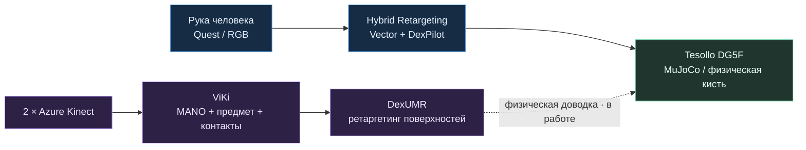
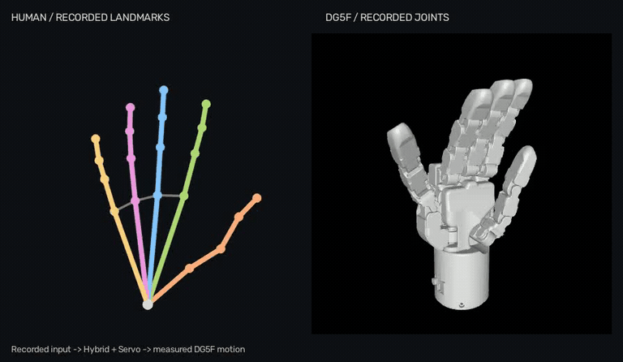
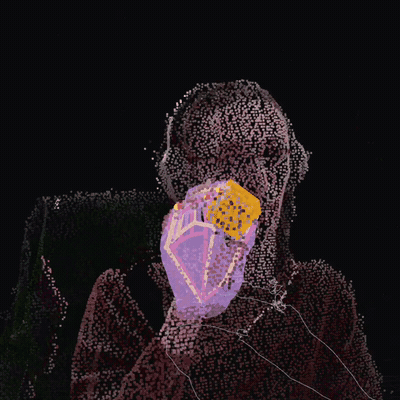
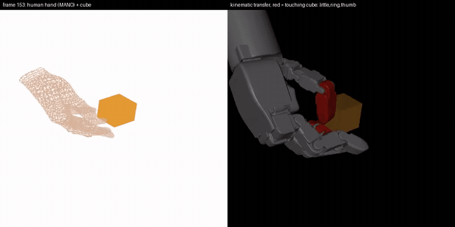

# DG5F · Hand Retargeting

Перенос движений человеческой кисти на **Tesollo DG5F**: онлайн-телеуправление и офлайн-работа с поверхностями кисти, предмета и контактами.

[Запуск и калибровка](docs/RUN_GUIDE.md) · [Запись датасета](docs/LEROBOT_DATASET_RECORDING.md) · [ViKi](https://github.com/vizitei-dmitri/ViKi_inference) · [DexUMR](https://github.com/VAlikV/DexUMR)



## 1 · Hybrid Retargeting

**21 точка кисти → Vector → ограниченная коррекция DexPilot → суставы DG5F.**

Vector сохраняет форму пальцев. При сближении большого пальца с остальными плавно подключается коррекция щипка. Результат используется для телеуправления, просмотра в MuJoCo и записи демонстраций.

[](docs/assets/demos/hybrid-retargeting.mp4)

<sub>Щипок: смыкание → удержание → раскрытие. Слева — записанные точки кисти, справа — измеренные углы DG5F после Hybrid + Servo, воспроизведённые в MuJoCo. Исходный темп, без дополнительного сглаживания. [Смотреть MP4](docs/assets/demos/hybrid-retargeting.mp4).</sub>

[Код ретаргетинга](src/dg5f_teleop/dg5f_teleop/retarget_node.py) · [Управление физической кистью](docs/DG5F_SERVO_RUNTIME_POLICY.md)

## 2 · Поверхности кисти и предмета

**RGB-D двух камер → MANO HandRT + куб 40 мм → траектории и контактные пары → экспериментальный перенос на DG5F.**

В [нашем форке ViKi](https://github.com/vizitei-dmitri/ViKi_inference) восстанавливаются меш кисти и положение куба в общей 3D-сцене. Метки задают ориентацию предмета, глубина и силуэты помогают его сопровождать.

[](docs/assets/demos/hand-object-reconstruction.mp4)

<sub>Фрагмент записи от 14 ноября: обработанная демонстрация в ViKi, воспроизведение в исходном темпе. Это промежуточная реконструкция. [Смотреть MP4](docs/assets/demos/hand-object-reconstruction.mp4).</sub>

Дальнейший перенос поверхностей и контактных областей развивается в [**DexUMR**](https://github.com/VAlikV/DexUMR), отдельном проекте на основе UMR:

[](docs/assets/demos/mesh-retargeting.mp4)

<sub>Слева — реконструкция человека, справа — кинематический результат DG5F; красным показаны участки вблизи куба. [MP4](docs/assets/demos/mesh-retargeting.mp4) · [Полное сравнение с физикой](docs/assets/demos/mesh-retargeting-physics.mp4).</sub>

**Текущий статус:** реконструкция, траектории и кинематический перенос работают офлайн. Контакты оцениваются по геометрии; устойчивое физическое удержание предмета ещё в работе.

## Части проекта

| Часть | Где находится |
|---|---|
| Hybrid, Quest / RGB, DG5F и LeRobot | Этот репозиторий: [ROS-пакеты](src/), [RGB-демо](docs/RUN_GUIDE.md#онлайн-с-rgb-камерой), [запись датасета](docs/LEROBOT_DATASET_RECORDING.md) |
| Запись двух Kinect, HandRT и куб | [ViKi_inference — наш форк ViKi](https://github.com/vizitei-dmitri/ViKi_inference), исходный [ViKi](https://github.com/artyomzifir/ViKi) |
| MANO → поверхность DG5F и контакты | [DexUMR](https://github.com/VAlikV/DexUMR) · экспериментальная ветка `experemental-hand` |
| Обучение манипуляциям в симуляции | [Isaac Lab extension](isaaclab_ext/dg5f_isaaclab/README.md) |

## Быстрый старт · Quest → MuJoCo

Из корня репозитория, с подключённым Quest и установленным Unity-приложением:

```bash
bash scripts/stack.sh setup
bash scripts/stack.sh usb
bash scripts/stack.sh gui-on
bash scripts/stack.sh launch 10000 hybrid
```

[Все режимы запуска, офлайн-проверка и калибровка →](docs/RUN_GUIDE.md)

[Общее направление проекта](docs/PROJECT_BACKGROUND.md) · [Источники демонстраций](docs/assets/demos/README.md) · [Сторонние компоненты и лицензии](THIRD_PARTY.md)
